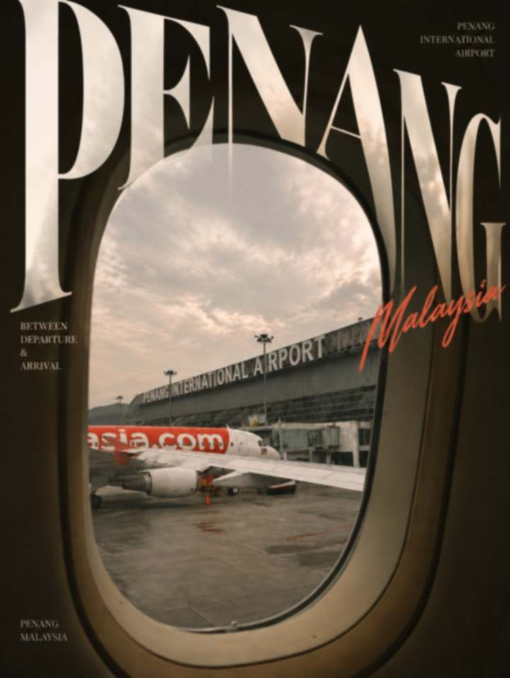
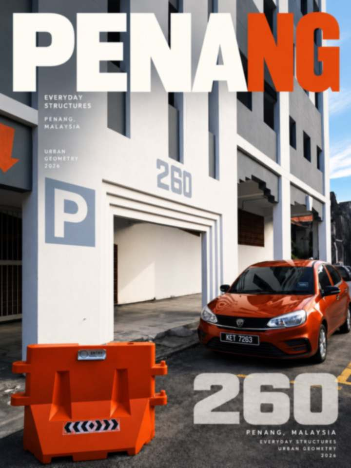
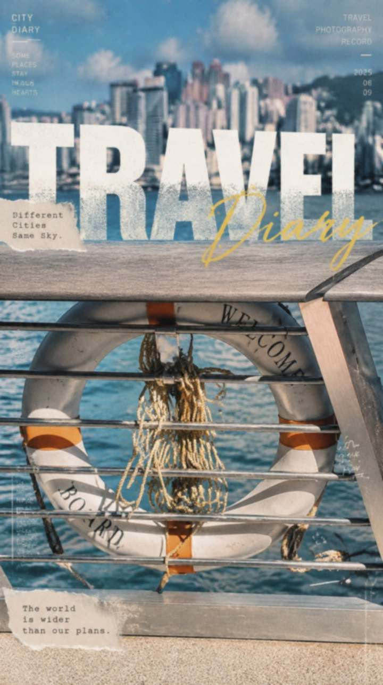
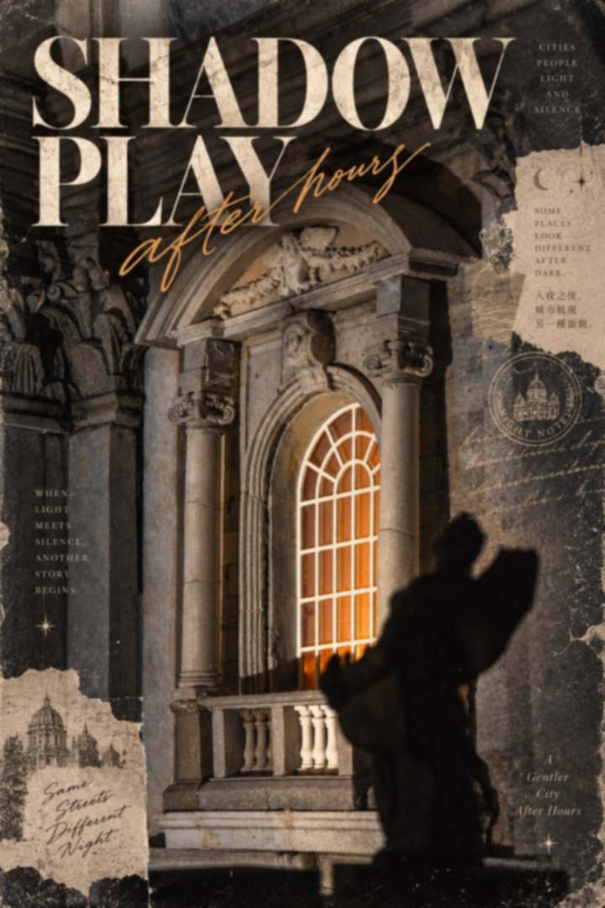
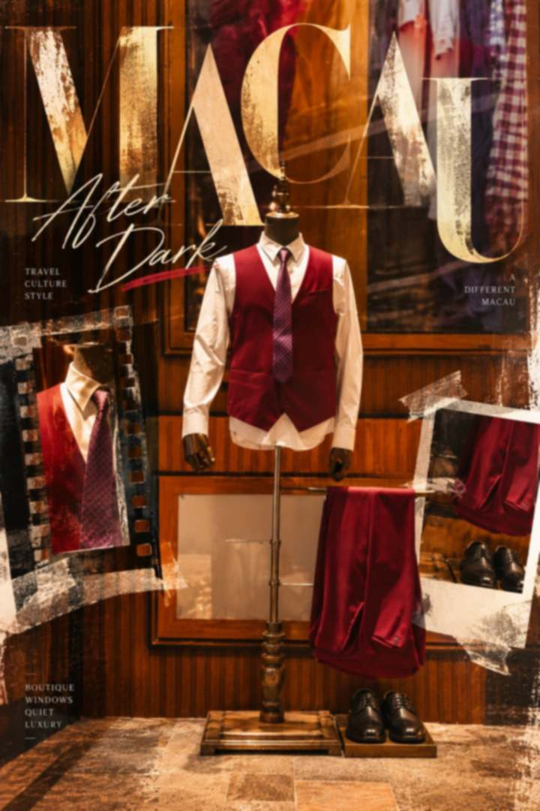
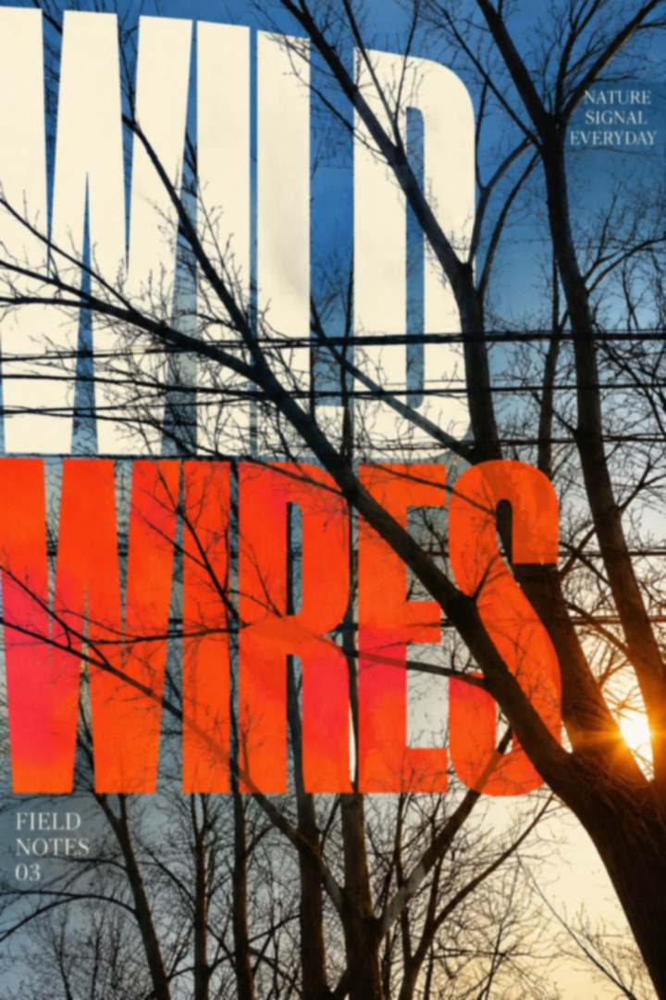

<p align="right"><sub><strong>English</strong> · <a href="README.zh-CN.md">简体中文</a></sub></p>

<h1 align="center">Photo → Poster</h1>

<p align="center"><em>The photograph stays. The page comes alive.</em></p>

<p align="center">
  An agent Skill that turns one photograph into an editorial poster,<br>
  a magazine cover, a postcard, or a photo-book cover.<br>
  One finished piece per run — designed, not decorated.
</p>

<p align="center">
  <a href="#examples">Examples</a> ·
  <a href="#the-recipe">The recipe</a> ·
  <a href="#use-the-skill">Use the Skill</a> ·
  <a href="#the-photograph-is-protected">Photo protection</a> ·
  <a href="CHANGELOG.md">Changelog</a>
</p>

<br>

<h3 align="center"><a name="examples"></a>Examples</h3>

<p align="center"><em>Six posters, six different recipes — no template repeated.</em></p>

<p align="center">
  
  
  
</p>
<p align="center">
  
  
  
</p>

<p align="center"><sub>
  The posters above are deliberately downscaled, lightly softened previews with no metadata — the original photographs are not part of this repository.<br>
  Inside the Skill itself, every case is still described as generalised design logic, in words only.
</sub></p>

<br>


<h3 align="center">A poster is a recipe, not a template</h3>

<p align="center"><em>Every photograph gets its own genre, its own type move, its own ornaments.</em></p>

The Skill reads the photograph first — its structure, its objects, its colors, its mood — then builds one creative recipe:

```text
Recipe = Format + Type move + Ornament set + Palette + Hierarchy
```

- **Format** — the genre of the piece: magazine cover, vintage print, zine collage, cinema one-sheet, field-guide plate, paper-frame photo book, postcard, Swiss grid, panel split, typographic monument, dreamy editorial.
- **Type move** — how the headline meets the photograph: occluded by a real object, knocked out, sliced, mirrored at a real horizon, warped like fabric, set standing in the scene's perspective.
- **Ornament set** — two to four purposeful devices from at least two families: torn paper, film strips, stamps and seals, a hand-drawn stroke, a map silhouette, drifting petals. Each one must earn its place; none may be filler.
- **Palette** — two or three colors sampled from the photograph itself. A spot color always echoes something real in the frame.
- **Hierarchy** — one hero, a few supporting layers, micro details, and one calm area for the eye.

<br>

<h3 align="center"><a name="the-recipe"></a>Why it doesn't repeat itself</h3>

The default output of an image model is a giant headline with an object overlapping it, plus a small caption. The Skill names that default, drafts three recipes in three different formats, and rejects the one closest to it. A recipe that is only a title treatment fails its own check — richness with hierarchy is the standard, and clutter is not the alternative.

<br>

<h3 align="center"><a name="the-photograph-is-protected"></a>The photograph is protected</h3>

- Never stretched, squashed, warped, or re-lit. Cropping is allowed, and is always disclosed.
- Nothing added to the scene, nothing removed, no repainted skies. Design is a layer built *around* the photograph.
- No invented facts: no fake dates, coordinates, issue numbers, or credits — on the page or on its ornaments.
- No AI tells: no meaningless short lines, fake UI, chrome or shattered-glass letters, dirty textures.
- Type placed on a real wall or plane must follow that plane's real perspective.
- Exactly one image per run. Directions are compared in planning, not by burning generations.

<br>

<h3 align="center"><a name="use-the-skill"></a>Use the Skill</h3>

Import the [Skill directory](skills/photo-to-poster/) into an agent that supports directory-based Skills, or ask it to read the [Skill instructions](skills/photo-to-poster/SKILL.md). Once active, upload a photograph. The Skill plans, critiques its own plan against the generic default, and produces a single finished piece.

Short follow-ups guide the next run:

```text
Same photo, different format.
Keep the concept; the type is too quiet.
Make it a vintage travel print.
```

The Skill adapts to what the host can do:

| Environment | What happens |
|---|---|
| **A — code + image tool** | The image tool generates only the design layer; code composites it over the original pixels and verifies them unchanged. |
| **B — image model only** | One call with a fully specified prompt: format, palette, headline, ornament set. The Skill warns that the model may shift color slightly. |
| **C — no image generation** | You receive the finished recipe and a ready-to-paste prompt. |

<h3 align="center">Repository layout</h3>

```text
photo-to-poster/
├── README.md                  ← you are here
├── README.zh-CN.md            ← 简体中文版
├── CHANGELOG.md
├── CONTRIBUTING.md
├── LICENSE                    ← MIT
├── examples/                  ← showcase posters (downscaled previews)
└── skills/
    └── photo-to-poster/
        └── SKILL.md           ← the Skill itself (English)
```

<br>

<p align="center"><sub>
  <a href="CONTRIBUTING.md">Contribute</a> ·
  <a href="CHANGELOG.md">Changelog</a> ·
  <a href="LICENSE">MIT License</a>
</sub></p>
