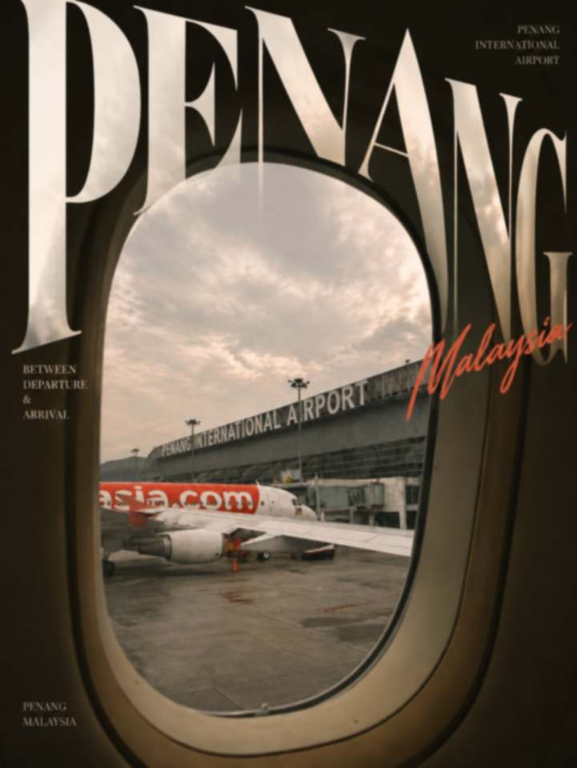
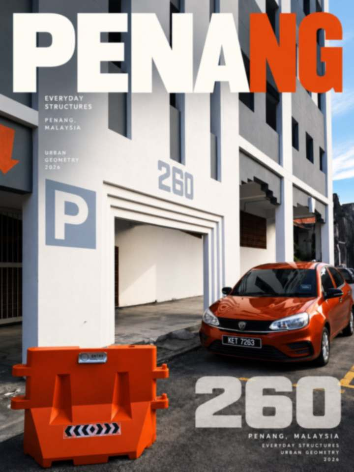
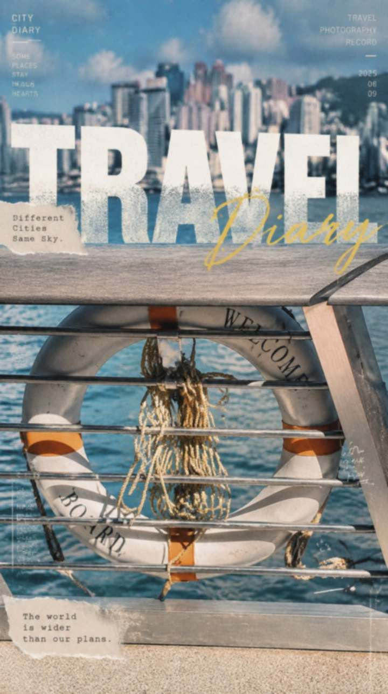
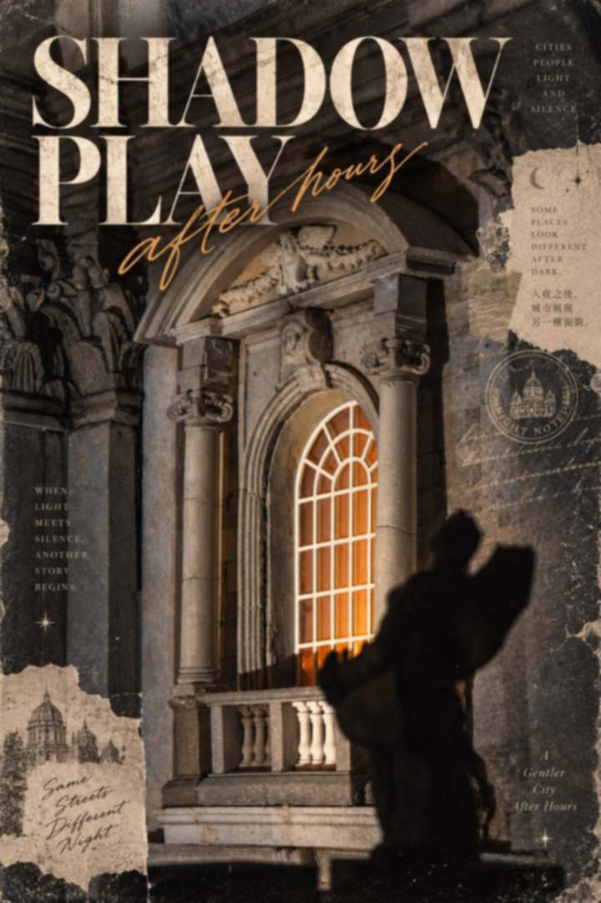
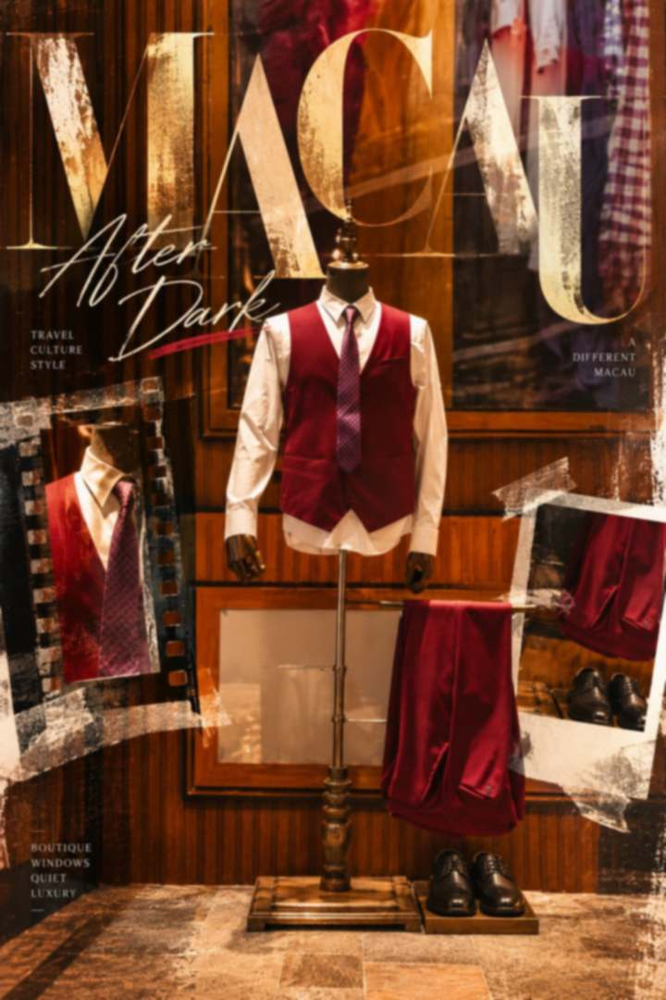
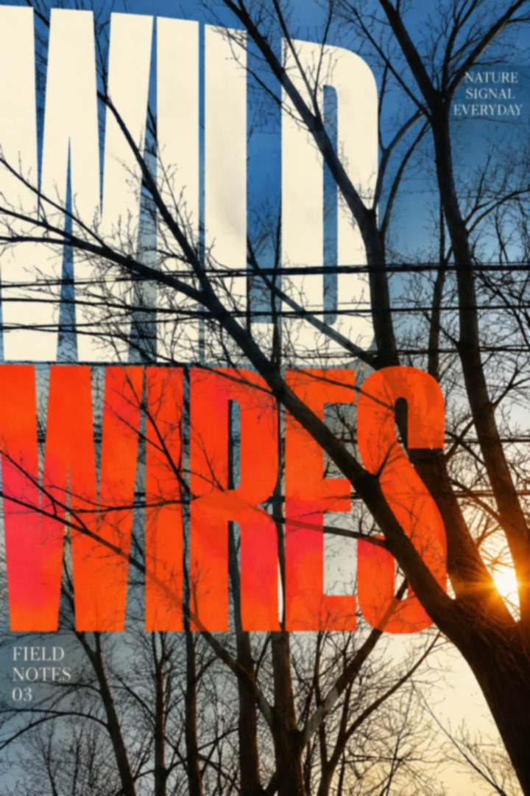

<p align="right"><sub><a href="README.md">English</a> · <strong>简体中文</strong></sub></p>

<h1 align="center">Photo → Poster</h1>

<p align="center"><em>照片还是那张照片，版面活过来。</em></p>

<p align="center">
  一个把单张照片做成编辑风格海报、杂志封面、明信片或摄影集封面的 agent Skill。<br>
  每次运行只出一张成品——靠设计，不靠堆装饰。
</p>

<p align="center">
  <a href="#配方">配方</a> ·
  <a href="#使用">使用 Skill</a> ·
  <a href="#原片保护">原片保护</a> ·
  <a href="CHANGELOG.md">更新记录</a>
</p>

<br>

<h3 align="center">案例展示</h3>

<p align="center"><em>六张海报，六份不同的配方——不重复同一个模板。</em></p>

<p align="center">
  
  
  
</p>
<p align="center">
  
  
  
</p>

<p align="center"><sub>
  以上海报均为刻意降低分辨率、轻微柔化且不带任何元数据的预览图——原始照片不在本仓库中。<br>
  Skill 本体内部的案例，仍然只以文字形式写成通用化的设计逻辑。
</sub></p>

<br>


<h3 align="center"><a name="配方"></a>海报是一份配方，不是一个模板</h3>

<p align="center"><em>每张照片都有自己的体裁、自己的字体动作、自己的装饰。</em></p>

Skill 会先读照片——结构、物体、颜色、氛围——然后为它构建一份专属配方：

```text
配方 = 体裁（Format）+ 字体动作（Type move）+ 装饰组（Ornament set）+ 配色（Palette）+ 层级（Hierarchy）
```

- **体裁**——整件作品的类别：杂志封面、复古印刷、拼贴 zine、电影海报、田野图鉴、纸框摄影集、明信片、瑞士网格、条带分割、字体纪念碑、梦幻编辑风。
- **字体动作**——标题与照片发生关系的方式：被真实物体遮挡、镂空成窗、被切成条带、在真实地平线处镜像、像织物一样流动、按场景透视立在画面里。
- **装饰组**——从至少两个家族里选 2–4 件有来由的装置：撕纸、胶片条、邮戳与印章、一笔连贯的手绘笔触、地图剪影、飘落的花瓣。每一件都必须有存在的理由，不许凑数。
- **配色**——从照片本身取 2–3 个颜色，点缀色必须呼应画面里真实存在的东西。
- **层级**——一个主角、少量配角、微小细节，再留一处让眼睛休息的安静区域。

<br>

<h3 align="center">为什么它不会每次都一样</h3>

生图模型的默认产出是「超大标题 + 物体压字 + 一行小字」。Skill 会先把这个默认说出来，再在脑中拟三份不同体裁的配方，否决最接近默认的那一份。只有标题、没有其他设计层的配方通不过它自己的检查——标准是「丰富而有层级」，而不是在简陋和杂乱之间二选一。

<br>

<h3 align="center"><a name="原片保护"></a>原片受保护</h3>

- 绝不拉伸、压扁、扭曲、重打光。允许裁切，但必须说明。
- 不给场景增删任何东西，不重绘天空。设计是围着照片搭起的一层，不是替换照片。
- 不虚构事实：不编日期、坐标、期号、署名——版面上和装饰上都不行。
- 不要 AI 味：无意义的短实线、假 UI、镀铬或玻璃碎裂字效、脏污质感，一律不要。
- 文字落在真实墙面或其他平面上时，必须顺着该平面的真实透视。
- 每次只生成一张。比较方向在策划阶段完成，不靠多烧生成次数。

<br>

<h3 align="center"><a name="使用"></a>使用 Skill</h3>

把 [Skill 目录](skills/photo-to-poster/) 导入支持目录式 Skill 的 agent，或让它直接阅读 [Skill 说明](skills/photo-to-poster/SKILL.md)。启用后上传一张照片即可：Skill 会先策划、再拿自己的方案和「通用默认」对照自检，最后只交付一张成品。

后续可以用短句引导下一次：

```text
同一张照片，换一个体裁。
概念保留，标题太弱了。
做成复古旅行印刷风。
```

Skill 会按宿主环境的能力分三档执行：

| 环境 | 做法 |
|---|---|
| **A — 有代码执行 + 生图工具** | 生图只生成设计层；程序把设计层叠在原图原始像素上，并校验原图未被改动。 |
| **B — 只有生图模型** | 一次调用、一条写全的提示词：体裁、配色、标题、装饰组都写明。Skill 会提醒：模型可能让照片轻微偏色。 |
| **C — 没有生图能力** | 交付完整的配方和一条可以直接粘贴使用的提示词。 |

<h3 align="center">仓库结构</h3>

```text
photo-to-poster/
├── README.md                  ← 英文版
├── README.zh-CN.md            ← 本文件
├── CHANGELOG.md
├── CONTRIBUTING.md
├── LICENSE                    ← MIT
├── examples/                  ← 案例海报（低分辨率预览图）
└── skills/
    └── photo-to-poster/
        └── SKILL.md           ← Skill 本体（英文）
```

<br>

<p align="center"><sub>
  <a href="CONTRIBUTING.md">参与贡献</a> ·
  <a href="CHANGELOG.md">更新记录</a> ·
  <a href="LICENSE">MIT 许可证</a>
</sub></p>
